# Helping Services — System Flowcharts (`flowchart.md`)

This document contains end-to-end visual workflows and decision flowcharts for the **Helping Services** backend architecture and algorithms.

---

## 1. User Registration & 3-Day Drop Email Reminder Lifecycle

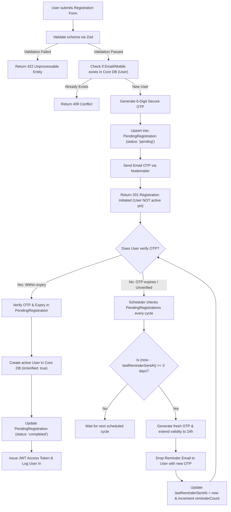

---

## 2. Personalized Product Feed Ranking Flow (Algorithms 1 & 2)

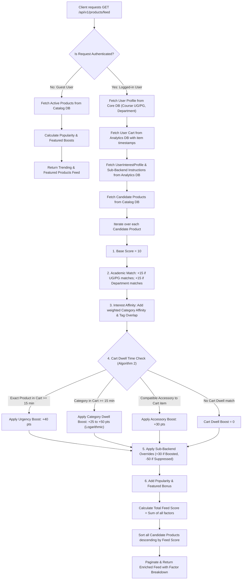

---

## 3. Cart Dwell Time Intent Boost Flow (Algorithm 2)

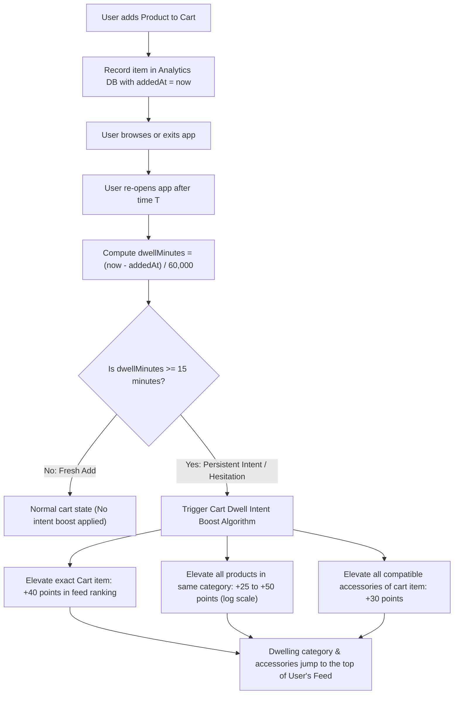

---

## 4. Contextual Accessory & Chained Cross-Sell Engine (Algorithm 3)

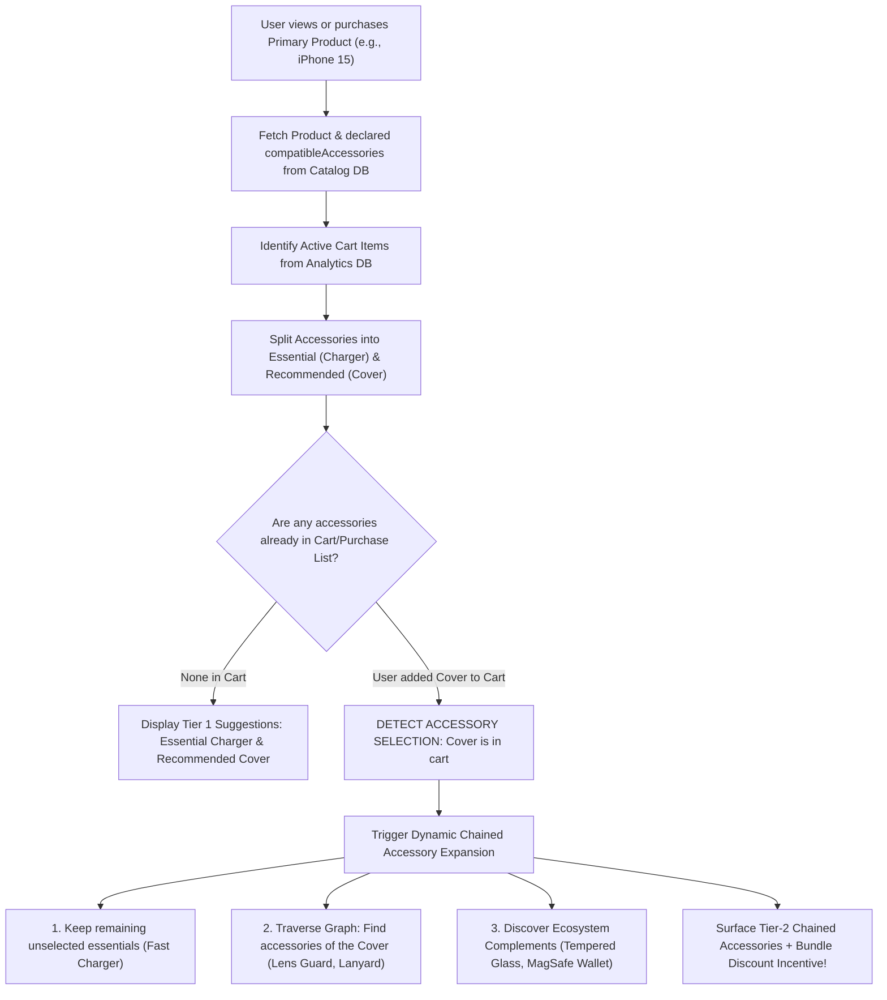

---

## 5. Multi-Database (Core, Catalog, Analytics) Interconnected Data Flow

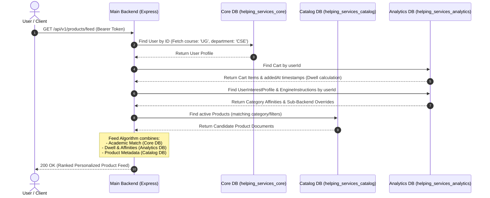

---

## 6. Sub-Backend (User Analysis Engine) Bidirectional Sync Flow

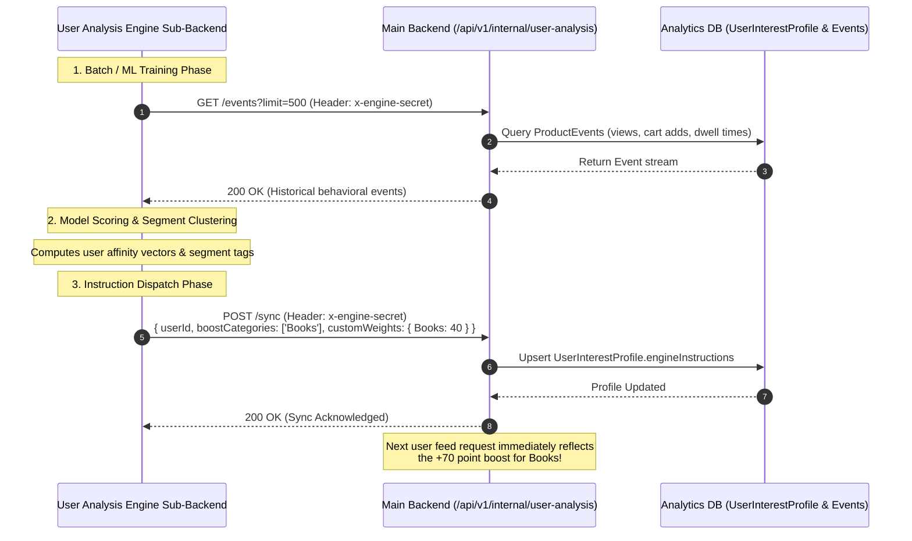

---

## 7. Intelligent Product Search Execution Pipeline (Algorithm 5)

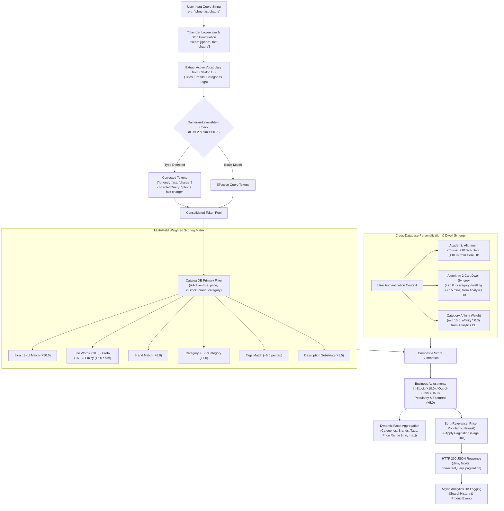

---

## 8. App & Partner Rating Prompt Scheduling & Re-Prompt Flowchart (Algorithm 6)

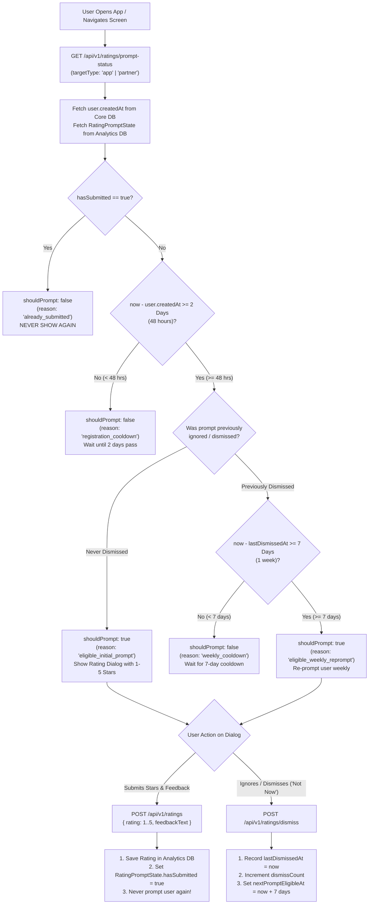

---

## 9. Ecosystem Version Handshake & Synchronization Flowchart

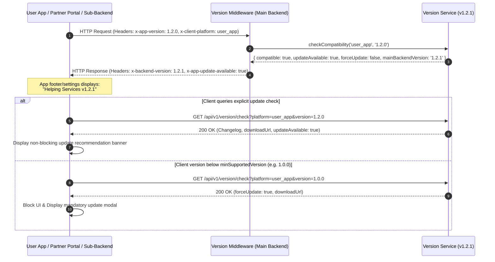

---

## 10. Real-Time Location Grabbing & Admin Sub-Backend Streaming Flowchart

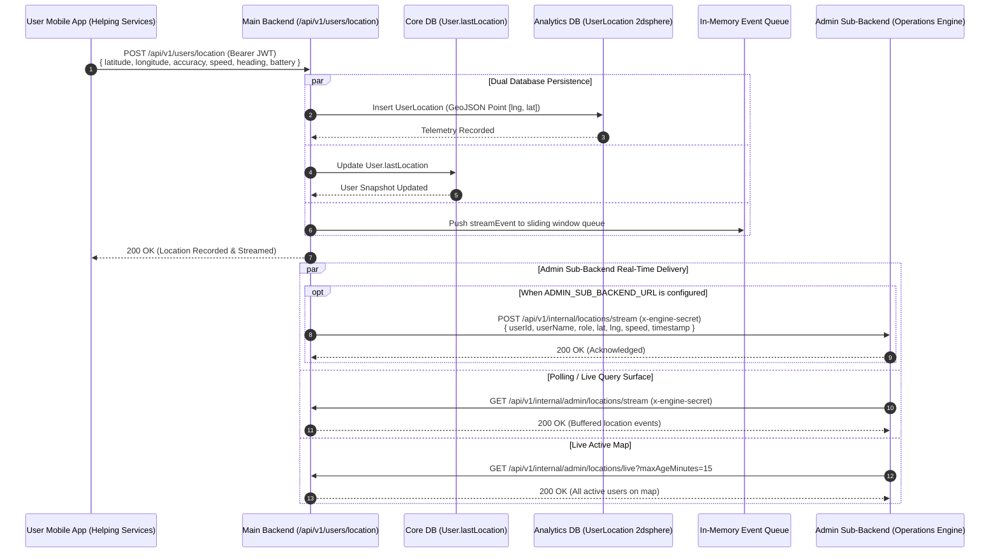

---

## 11. Real-Time OS & Device Telemetry Grabbing & Admin Sub-Backend Streaming Flowchart

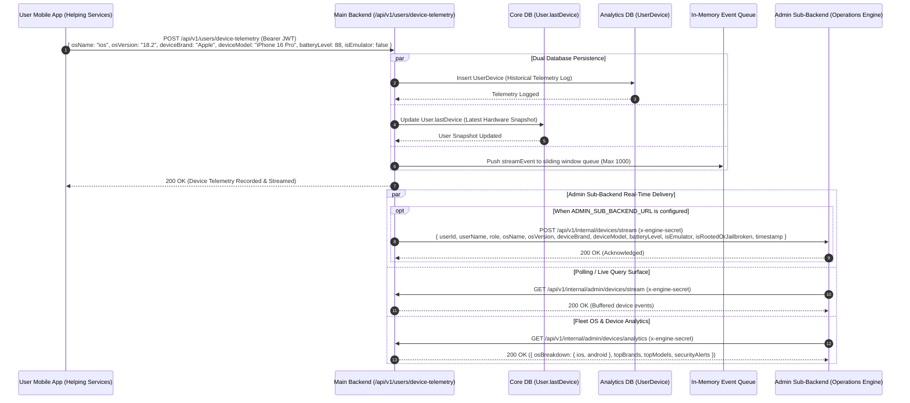

---

## 12. In-App Notification Lifecycle & Device Push Sequence Flowchart

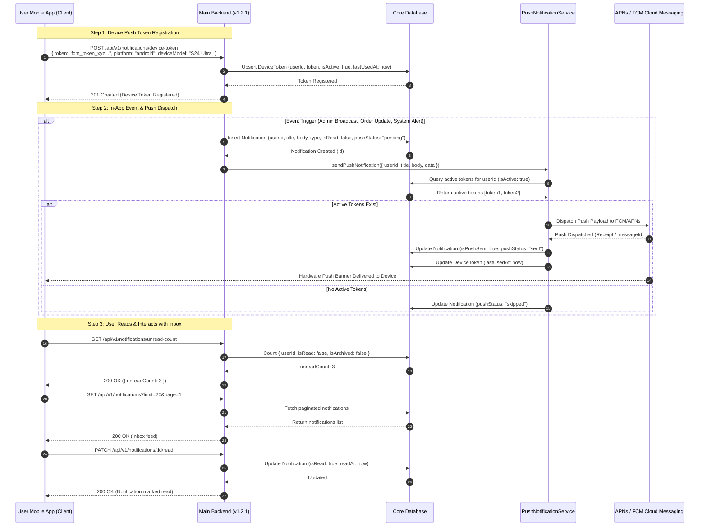

---

## 13. Order Checkout, Partner Claim & Delivery Flowchart

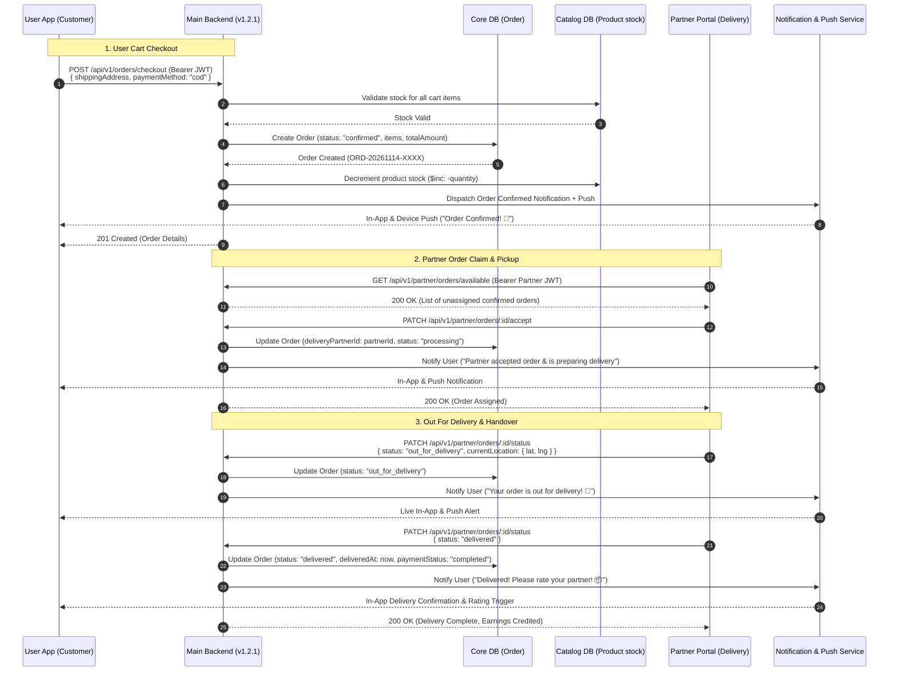

